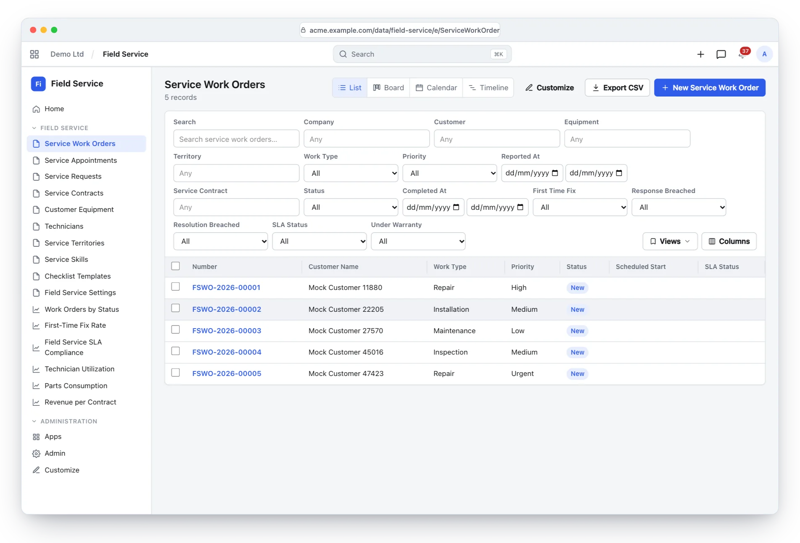
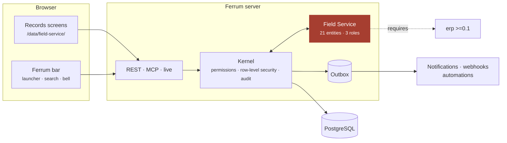
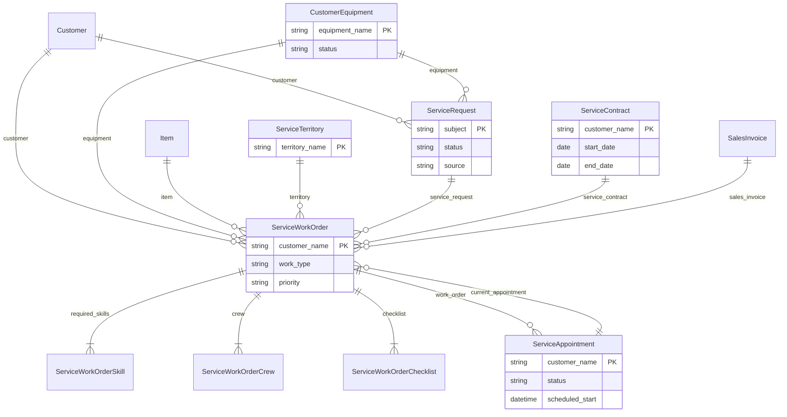

<div align="center">

<picture>
  <source media="(prefers-color-scheme: dark)" srcset="docs/assets/banner-dark.svg">
  
</picture>

[](https://github.com/CBFerrum/ferrum-app-field-service/actions/workflows/ci.yml)     

**A native app for [Ferrum](https://github.com/CBFerrum/Ferrum), the open-source, AI-first business platform.**

[Overview](#overview) · [Highlights](#highlights) · [Screenshots](#screenshots) · [How it works](#how-it-works) · [Data model](#data-model) · [Install](#install) · [Develop](#develop) · [Changelog](#changelog)

</div>

---

## Overview

Ferrum Field Service runs work in the field. Requests arrive from staff, the helpdesk or
customers and become work orders with a site, equipment, a checklist and SLA deadlines;
appointments assign one or more technicians without double booking; dispatch ranks technicians by
skills, territory, hours and travel; and completed work is checked, signed and invoiced exactly
once.


| At a glance | |
|---|---|
| 📦 Version | `0.1.1` |
| 🧱 Platform | Ferrum `>=0.3.1, <0.4` |
| 🔗 Requires | erp `>=0.1` |
| 🖥️ Interface | Ferrum's records screens (`/data/field-service/`) |
| 🗃️ Records | 21 entities in 1 package |
| 👥 Roles | 3: Service Manager, Dispatcher, Technician |
| 📊 Reports | 6 |
| 🧪 Tests | 11 Rust tests |


## Highlights

<table>
<tr>
<td width="50%" valign="top">

### 📨 Requests from anywhere
Staff, Helpdesk tickets and a rate-limited public endpoint for customers.

</td>
<td width="50%" valign="top">

### 🧰 Work orders
Site, equipment, checklist, parts, labour, expenses, photos and the customer's signature.

</td>
</tr>
<tr>
<td width="50%" valign="top">

### ⏱️ SLA deadlines
From the service contract or the priority, with breach flags kept current.

</td>
<td width="50%" valign="top">

### 🧭 Explainable dispatch
Technicians ranked by skills, territory, hours and travel; no double booking.

</td>
</tr>
<tr>
<td width="50%" valign="top">

### 🧾 Invoiced once
Parts, labour and billable expenses invoiced exactly once on completion.

</td>
<td width="50%" valign="top">

### 🛡️ Installed base
Equipment with warranties and contracts that plan each visit once.

</td>
</tr>
</table>

## Screenshots

<picture>
  <source media="(prefers-color-scheme: dark)" srcset="docs/assets/field-service-dark.webp">
  
</picture>

<p align="center"><sub>Work orders by type, priority and status.</sub></p>

> [!TIP]
> The screenshots follow your GitHub theme: switch between light and dark to see both.

## How it works

### A work order


### Inside Ferrum



Everything Field Service adds is ordinary Ferrum metadata and Rust: its records get lists, forms,
search, permissions, an audit trail, exports and the REST and MCP APIs for free, so AI agents work
with them under the same rules as people.

## Data model

The main records and how they connect (21 entities in all; `packages/` has every field).



### Roles

| Role | What it is for | Entities |
|---|---|---|
| **Service Manager** | Runs field service — settings, technicians and their costs, contracts, requests, work orders, appointments — and invoices completed work. | 25 |
| **Dispatcher** | Takes service requests, plans, schedules and dispatches work orders, and keeps the installed base up to date. | 15 |
| **Technician** | Works the work orders and appointments assigned to them — travel, arrival, checklist, parts, time, expenses, signature, completion — and files service requests. | 14 |

<details>
<summary><b>Reports (6)</b></summary>

- Fs Work Order Summary
- Fs First Time Fix
- Fs Sla Compliance
- Fs Technician Utilization
- Fs Parts Consumption
- Fs Contract Revenue

</details>

## Install

Workspace administrators install it from **Apps** (`/store/`) in Ferrum; it ships in the
official Ferrum server image. It needs **erp** `>=0.1` installed first. Self-hosters building their own image enable the
`field-service` feature of the server. Everything it adds is also available to AI agents over
Ferrum's MCP server, within each person's permissions.

## Develop

Clone it next to the platform:

```text
work/
├── ferrum/            https://github.com/CBFerrum/Ferrum
└── ferrum-app-field-service/
```

Point the platform dependencies at your checkout (this file is git-ignored):

```toml
# .cargo/config.toml
[patch."https://github.com/CBFerrum/Ferrum"]
ferrum-calc = { path = "../ferrum/crates/calc" }
ferrum-domain = { path = "../ferrum/crates/domain" }
ferrum-kernel = { path = "../ferrum/crates/kernel" }
ferrum-meta = { path = "../ferrum/crates/meta" }
```

The tests need PostgreSQL with an ordinary (non-superuser) role, so row-level security
applies:

```bash
createuser ferrum --pwprompt && createdb -O ferrum ferrum_field_service_test
cargo test
```

`FERRUM_FIELD_SERVICE_TEST_DATABASE_URL` overrides the database URL.


### Project layout

```text
app.yaml      the manifest: id, version, requirements, what it adds to Ferrum
packages/     metadata: entities, roles, reports, workflows, print formats
src/          the app's logic in Rust: hooks, actions, endpoints, upkeep jobs
tests/        integration tests against a real PostgreSQL
CHANGELOG.md  what changed in each version
```

## Changelog

| Version | Highlights |
|---|---|
| **0.1.1** | Requires the ERP app : installing it in a workspace without ERP installs ERP whole, with its interface, rather than a few of its packages. |
| **0.1.0** | First release: field service on Ferrum's own customers, items, stock and books. Service requests from staff, the helpdesk and a rate-limited … |

Every version is in [CHANGELOG.md](CHANGELOG.md).

## License

[AGPL-3.0-only](LICENSE), like the platform. Part of [Ferrum](https://github.com/CBFerrum/Ferrum) ·
[Report an issue](https://github.com/CBFerrum/ferrum-app-field-service/issues)
